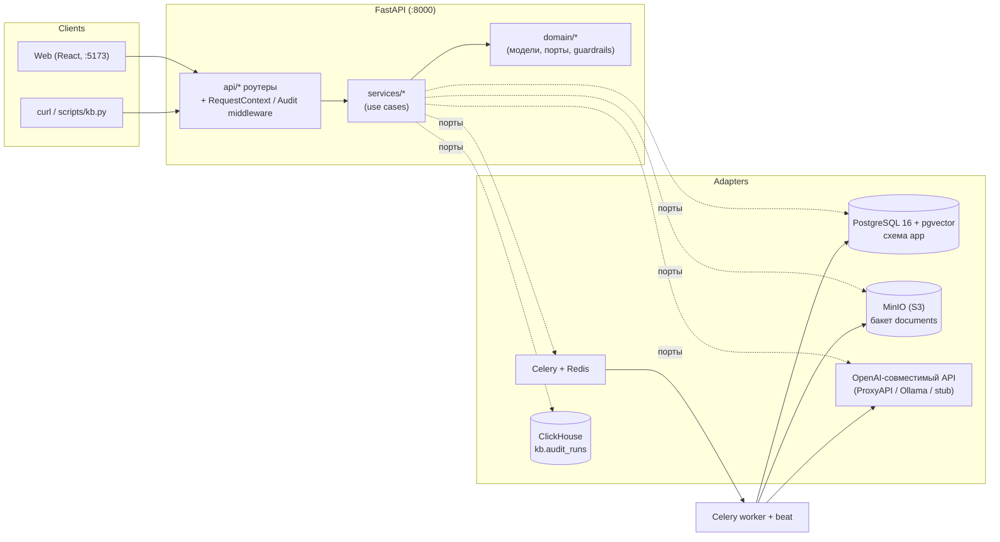
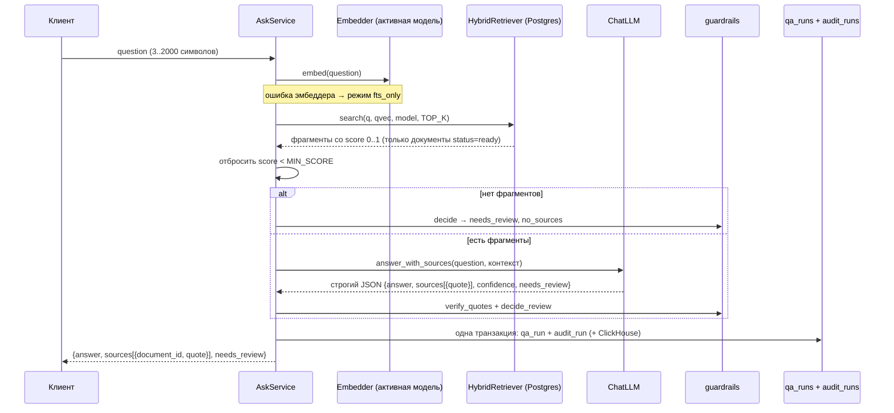

# Team Memory — база знаний команды с ответами по источникам

Сервис, где команда хранит внутренние документы (регламенты, FAQ, шаблоны, глоссарий) и задаёт к ним
вопросы на естественном языке. Ответ строится **только** по найденным фрагментам базы и всегда
сопровождается дословными цитатами с `document_id`; если данных нет или ответ нельзя подтвердить —
сервис честно говорит «Данных недостаточно…» и помечает вопрос на ручную проверку.

> Пошаговые заметки по этапам разработки (1–8) — в [README-steps.md](README-steps.md).

## Содержание

1. [Описание проекта](#1-описание-проекта)
2. [Архитектура](#2-архитектура)
3. [Состав проекта](#3-состав-проекта)
4. [Установка и запуск](#4-установка-и-запуск)
5. [Переменные окружения](#5-переменные-окружения)
6. [Примеры запросов (curl)](#6-примеры-запросов-curl)
7. [Где лежит БД и как смотреть данные и аудит](#7-где-лежит-бд-и-как-смотреть-данные-и-аудит)
8. [Ручная проверка: как воспроизвести](#8-ручная-проверка-как-воспроизвести)
9. [.env.example](#9-envexample)

---

## 1. Описание проекта

**Team Memory** — «память команды»:

- **Документы.** Добавляются JSON-ом `{title, text}` или загрузкой файла `.txt`/`.md` (UTF-8, до
  `MAX_UPLOAD_MB`). Оригинал файла хранится в MinIO (S3), текст режется на фрагменты по абзацам
  (`app/domain/chunking.py`, текст фрагментов — дословно из источника) и индексируется в фоне
  (Celery): полнотекстовый индекс Postgres (`russian`) + эмбеддинги в pgvector.
- **Вопросы и ответы (Q&A) с цитатами.** `POST /kb/ask` находит релевантные фрагменты, передаёт их LLM
  со строгой JSON-схемой ответа, затем **проверяет каждую цитату**: она должна быть буквальной подстрокой
  (после нормализации регистра, «ё», кавычек, тире и пробелов) одного из найденных фрагментов. Ответ
  возвращается как `{answer, sources:[{document_id, quote}], needs_review}`.
- **Инварианты `needs_review`** (проверяются и в коде — `app/domain/guardrails.py`, и в БД —
  CHECK-ограничения таблицы `app.qa_runs`):
  - `needs_review=false` ⇒ `sources` не пуст и все цитаты подтверждены;
  - `needs_review=true` ⇒ указана причина (`error`): `no_sources`, `low_confidence`,
    `unverified_quote`, `llm_invalid_json`, `llm_error`;
  - при `needs_review=true` ответ всегда равен
    **«Данных недостаточно для ответа. Вопрос передан на ручную проверку.»**
    (для `unverified_quote` подтверждённые цитаты сохраняются для проверяющего).
- **`/kb/ask` всегда отвечает 200** (кроме ошибок валидации): сбои LLM, невалидный JSON, отсутствие
  фрагментов превращаются в `needs_review=true` с причиной, а не в 5xx.
- **История и очередь ручной проверки**: каждый вопрос сохраняется в `app.qa_runs`
  (`GET /kb/qa_runs?needs_review=true`).
- **Аудит**: каждая команда API (добавление документа, вопрос, прямой вызов LLM, админ-операции,
  ошибки 4xx/5xx) пишется в `audit_runs` — в Postgres и/или ClickHouse.
- **Веб-панель** (React): вкладки «Документы», «Вопросы», «История», «Админ».
- **Эксплуатация**: админ-API с blue/green-сменой модели эмбеддингов, health-проверки, JSON-логи с
  `X-Request-ID`, Prometheus-метрики, бэкап/восстановление.

LLM и эмбеддинги — любой OpenAI-совместимый API: по умолчанию OpenAI через **ProxyAPI**
(`https://api.proxyapi.ru/openai/v1`), локально — **Ollama**, для тестов и офлайна — детерминированные
stub-модели (без сети и ключей).

---

### Как пользоваться приложением

Веб-панель (http://localhost:5173) состоит из четырёх вкладок: **Документы**, **Вопросы**, **История** и **Админ**. Работа начинается с вкладки **Документы**: сюда добавляются регламенты, инструкции и другие тексты команды — вручную (название и текст) или загрузкой файла `.txt`/`.md`. После добавления документ индексируется в фоне; в списке виден его статус (`uploaded` → `indexing` → `ready`, при сбое — `failed` с текстом ошибки). Искать можно только по документам в статусе `ready`.

На вкладке **Вопросы** пользователь задаёт вопрос обычным языком. Приложение находит подходящие фрагменты в базе знаний, формирует ответ и показывает под ним дословные цитаты со ссылками на документы-источники. Если в базе нет данных для ответа или модель не уверена, вместо ответа выводится «Данных недостаточно…», а вопрос помечается для ручной проверки (`needs_review`) с указанием причины. Все заданные вопросы, ответы и источники сохраняются на вкладке **История**; там же можно отфильтровать вопросы, ожидающие ручной проверки.

Вкладка **Админ** (доступ по токену `ADMIN_TOKEN`) показывает состояние сервисов (Postgres, MinIO, Redis, LLM, эмбеддер) и позволяет сменить модель эмбеддингов без остановки сервиса: зарегистрировать новую модель (провайдер, имя, размерность), запустить переиндексацию всех фрагментов и следить за прогрессом, затем активировать её — поиск переключится на новую модель атомарно, а старую можно удалить. Чат-модель (LLM) и провайдер (OpenAI через ProxyAPI, Ollama или любой OpenAI-совместимый сервис) меняются через переменные окружения `LLM_*`/`EMBED_*` в `.env` с перезапуском (`make up`).

## 2. Архитектура

### 2.1. Гексагональная архитектура (ports & adapters)

```
backend/app/
  domain/      модели (pydantic), ошибки, порты (Protocol), чанкинг, guardrails, промпты — чистый Python
  services/    сценарии (use cases): DocumentService, IndexingService, AskService, AiAnswerService,
               QaRunService, AuditService, AdminService, HealthService — зависят только от портов
  adapters/    реализации портов: postgres, memory, s3, openai_compat, stubs, celery_queue, clickhouse
  api/         FastAPI-роутеры, DTO, маппинг ошибок
  composition.py  единственное место, где выбираются и собираются адаптеры (composition root)
```

Границы проверяются **import-linter** (4 контракта в `backend/pyproject.toml`):
«Domain is independent», «Services do not import adapters or api», «Only composition.py imports adapters»,
«Domain and services are infrastructure-free» (в domain/services запрещены sqlalchemy, fastapi, boto3,
celery, httpx, clickhouse_connect, prometheus_client, starlette и т. п.).

Основные порты (`app/domain/ports.py`): `UnitOfWork` (репозитории documents/snippets/qa_runs/audit),
`Retriever`, `Embedder`, `ChatLLM`, `FileStorage`, `TaskQueue`, `AuditSink`, `EmbeddingModelRegistry`.
У каждого порта есть in-memory/stub-реализация и общий набор **контрактных тестов**
(`backend/tests/contract/`), которые прогоняются и на memory, и на реальном Postgres/S3/ClickHouse.



### 2.2. Поток запроса `POST /kb/ask`



1. **Гибридный поиск** (`app/adapters/postgres/retriever.py`):
   - FTS: `to_tsvector('russian', …)` (GIN-индекс), score — доля лексем вопроса, найденных во фрагменте;
   - вектор: косинусная близость `1 - (embedding <=> q)` только по **активной** модели эмбеддингов,
     через частичный HNSW-индекс этой модели;
   - слияние — **Reciprocal Rank Fusion**: порядок по `Σ 1/(RRF_K + rank)`;
   - итоговый `score = max(fts_score, cosine)` ∈ [0..1], поэтому один порог `MIN_SCORE` работает для обоих
     каналов. Возвращается `TOP_K` фрагментов.
2. **Порог `MIN_SCORE`** (по умолчанию 0.6): ниже — фрагмент не попадает к LLM; если не осталось ни одного —
   LLM не вызывается, ответ «Данных недостаточно…», причина `no_sources`.
3. **LLM** получает системный промпт «отвечай ТОЛЬКО по контексту» и пронумерованные фрагменты; ответ
   валидируется строгой схемой (`json_schema`, или `json_object` для серверов без structured outputs).
4. **Проверка цитат**: цитата длиной ≥ 8 символов должна дословно (после нормализации) входить во
   фрагмент; `document_id` берётся из найденного фрагмента, а не из ответа LLM.
5. **Решение** (`decide_review`): ошибка LLM → `llm_error`/`llm_invalid_json`; `confidence=low` или
   `needs_review` от модели → `low_confidence`; неподтверждённая цитата → `unverified_quote`; нет цитат →
   `no_sources`; иначе `needs_review=false`.

### 2.3. Индексация через Celery

`POST /kb/documents` сохраняет документ (`status=indexing`) и ставит задачу `index_document` в Redis.
Worker режет текст на фрагменты, считает эмбеддинги активной моделью и переводит документ в `ready`
(или `failed` с `status_error` после `INDEX_MAX_RETRIES` попыток с backoff `INDEX_RETRY_BACKOFF_S`).
Поиск видит только `ready`-документы. Beat ежедневно (03:17 UTC) создаёт месячные партиции
`app.audit_runs` на `AUDIT_PARTITIONS_MONTHS` вперёд. При `QUEUE_BACKEND=inline` (тесты) индексация
выполняется синхронно — документ сразу `ready`.

### 2.4. Blue/green-смена модели эмбеддингов

Реестр `app.embedding_models` (статусы `indexing → ready → active → retired`, при сбое — `failed` с
текстом `error`) и таблица `app.snippet_embeddings` с векторами всех моделей (своя размерность и свой
частичный HNSW-индекс на модель). Новая модель регистрируется через `/admin`, переиндексируется задачей
`reindex_embedding_model`, пока старая продолжает обслуживать поиск; `activate` дозаполняет хвост,
проверяет 100 % покрытие и атомарно переключает активную модель (уникальный индекс «одна active»).
API и worker подхватывают новую модель без перезапуска (кэш ~5 с). `qa_runs.embedding_model` показывает,
какой моделью получен ответ.

### 2.5. Аудит: Postgres и/или ClickHouse

Порт `AuditSink`, выбор — `AUDIT_BACKEND`:
- `postgres` (по умолчанию) — `app.audit_runs`, партиционирована по месяцам, запись в той же транзакции,
  что и `qa_runs`;
- `clickhouse` — `kb.audit_runs` (MergeTree, партиции по месяцу, TTL 365 дней), запись в Postgres отключается;
- `both` — в обе базы.

Сбой ClickHouse не ломает запросы. Ошибочные запросы (4xx/5xx) пишет `AuditMiddleware`; размер
сохраняемого тела ограничен `AUDIT_MAX_BODY_KB`.

### 2.6. Библиотеки и почему именно они

| Библиотека | Где | Зачем / почему |
|---|---|---|
| **FastAPI** + uvicorn | `app/api`, `app/main.py` | async, валидация pydantic «из коробки», OpenAPI/Swagger (`/docs`), DI через `Depends` |
| **pydantic v2**, **pydantic-settings** | domain, `app/config.py` | строгие модели домена и ответа LLM (`extra=forbid`, `strict`); конфигурация из `.env` с типами и значениями по умолчанию |
| **SQLAlchemy 2.0 async** (ORM + Core) | `adapters/postgres` | ORM-модели и Unit of Work для CRUD, Core/`text()` для FTS/pgvector/RRF-SQL, где ORM мешает |
| **asyncpg** | драйвер | самый быстрый async-драйвер Postgres, нативно с SQLAlchemy |
| **Alembic** | `backend/migrations` | версионируемые миграции схемы `app` (`0001`…`0003`) |
| **PostgreSQL 16 + pgvector** | docker `pgvector/pgvector:pg16` | одна БД для документов, FTS (`russian`), векторов (HNSW), истории и аудита: транзакции, CHECK-инварианты, JOIN поиска со статусом документа |
| **boto3** (S3-клиент) | `adapters/s3` | стандартный S3 API: MinIO локально, любой S3 в проде; presigned-ссылки на оригиналы |
| **MinIO** | docker `pgsty/minio` | S3-совместимое хранилище оригиналов файлов (бакет `documents`) |
| **httpx** — свой OpenAI-совместимый клиент | `adapters/openai_compat` | вместо SDK `openai`: одна лёгкая зависимость, явные таймауты/ретраи, тесты через `httpx.MockTransport`; работает с OpenAI через **ProxyAPI**, Ollama, vLLM |
| **Celery + Redis** | `adapters/celery_queue` | фоновая индексация с ретраями и backoff, beat для обслуживания партиций, прогресс переиндексации |
| **clickhouse-connect** | `adapters/clickhouse` | официальный HTTP-клиент ClickHouse; вызовы через `asyncio.to_thread` |
| **prometheus-client** | `app/observability.py` | `/metrics`: счётчики и гистограмма длительности HTTP-запросов |
| **React 18 + Vite 5 + TypeScript** | `web/` | быстрый dev-сервер, типизированный клиент API, без UI-библиотек |
| **vitest** + Testing Library | `web/src/test` | тесты компонентов с мок-`fetch`, совместимы с Vite |
| **pytest** + pytest-asyncio | `backend/tests` | unit / contract / api / integration / acceptance / live |
| **ruff**, **mypy (strict)**, **import-linter** | `backend` | линт и форматирование, статическая типизация, контроль границ гексагональной архитектуры |
| **uv** | `backend/uv.lock` | быстрая и воспроизводимая установка зависимостей (lock-файл), Python 3.12 |

**Почему не Haystack.** Пайплайн RAG здесь короткий (поиск → порог → LLM → проверка цитат), но с жёсткими
требованиями: один SQL с FTS + pgvector + RRF и фильтром по статусу документа, свой порог
`MIN_SCORE`, строгая схема ответа и детерминированная верификация цитат с инвариантами `needs_review`.
Haystack добавил бы тяжёлую зависимость и собственные абстракции хранилищ/компонентов поверх этого
кода, усложнил бы тестирование на stub-адаптерах и контроль границ. Порты позволяют подключить его позже
отдельным адаптером (заготовка `app/adapters/rag_haystack/` пуста и не используется).

**Почему не SQLite / Chroma.** Нужны конкурентная запись API + worker, транзакции «ответ + аудит»,
CHECK-ограничения, партиционирование аудита, русский FTS и векторы в одном запросе. SQLite не даёт
нормальной конкурентности и pgvector/`russian` FTS; Chroma — только векторное хранилище: пришлось бы
синхронизировать две базы (метаданные/аудит и векторы) без общей транзакции и без гибридного поиска
в одном SQL. Postgres + pgvector закрывает всё одной системой.

---

## 3. Состав проекта

```
knowledgebase/
├── README.md                  это описание
├── README-steps.md            заметки по этапам 1–8
├── Makefile                   все команды разработки и эксплуатации
├── docker-compose.yml         postgres, minio, minio-init, redis, api, worker, beat, web;
│                              профили: test (api-test), clickhouse, ollama
├── .env.example               пример переменных окружения (копируется в .env: make env)
├── .github/workflows/ci.yml   CI: web (lint/typecheck/test/build), backend (ruff/mypy/import-linter/pytest), integration
├── backend/
│   ├── Dockerfile             образ api/worker/beat (uv sync, uvicorn app.main:app)
│   ├── pyproject.toml, uv.lock  зависимости, настройки ruff/mypy/pytest/import-linter
│   ├── alembic.ini
│   ├── migrations/versions/   0001_init (схема app, pgvector), 0002_schema (таблицы, индексы, партиции),
│   │                          0003_embedding_model_error (статус failed + error в реестре моделей)
│   ├── app/
│   │   ├── main.py            create_app(): роутеры, CORS, middleware (request id, аудит), /metrics
│   │   ├── config.py          Settings (pydantic-settings) — все переменные окружения
│   │   ├── composition.py     composition root: выбор адаптеров по настройкам, Container
│   │   ├── observability.py   JSON-логи, X-Request-ID, Prometheus-метрики
│   │   ├── domain/            models, ports, errors, chunking, guardrails, prompts, health
│   │   ├── services/          documents, indexing, ask, ai_answer, qa_runs, audit, admin, embedding, health
│   │   ├── adapters/
│   │   │   ├── postgres/      ORM, репозитории, UoW, гибридный ретривер, реестр моделей, health
│   │   │   ├── memory/        in-memory реализации всех портов (тесты, режим без БД)
│   │   │   ├── s3/            хранилище файлов (boto3) + health
│   │   │   ├── openai_compat/ httpx-клиент, ChatLLM, Embedder, health
│   │   │   ├── stubs/         детерминированные stub-LLM и stub-эмбеддер (hash)
│   │   │   ├── celery_queue/  TaskQueue, worker (index_document, reindex_embedding_model, reindex_all,
│   │   │   │                  ensure_audit_partitions), health Redis
│   │   │   ├── clickhouse/    ClickHouseAuditSink, DDL, health
│   │   │   ├── rag_haystack/, audit_kafka/   пустые заготовки (не используются)
│   │   └── api/               documents, ask, ai, qa_runs, health, admin, audit (middleware), schemas, errors
│   └── tests/
│       ├── unit/              домен и сервисы на memory/stub
│       ├── contract/          одинаковые тесты портов для memory и Postgres/S3/ClickHouse
│       ├── api/               HTTP-тесты через ASGI-клиент (memory)
│       ├── integration/       только с TEST_DATABASE_URL (Postgres-специфика, гибридный поиск, blue/green)
│       ├── acceptance/        приёмка на датасете tests_data (memory) и сценарии ТЗ на Postgres
│       └── live/              реальный LLM-провайдер (маркер live, платно)
├── web/                       React + Vite + TS: src/api (клиент и типы), src/components (вкладки),
│                              src/test (vitest), router.ts (hash-маршруты)
├── tests_data/                kb_documents.jsonl (5 документов), kb_questions.jsonl (10 вопросов)
├── scripts/
│   ├── kb.py                  seed / eval / acceptance против запущенного API (stdlib)
│   ├── smoke.sh               smoke-тест 3 сценариев ТЗ
│   ├── backup.sh, restore.sh  бэкап/восстановление Postgres + MinIO
└── docker/
    ├── postgres/init/         создание БД kb_test (+ vector) при первом старте
    └── clickhouse/init/       001_audit.sql — DDL kb.audit_runs
```

---

## 4. Установка и запуск

### 4.1. Что нужно

- **Docker** с Compose v2 (`docker compose`) — для всего стека;
- **make**, **curl**, **python3** (для `scripts/kb.py`, только stdlib);
- для разработки без Docker: **uv** (Python 3.12 ставится через `uv python install 3.12`) и
  **Node.js 20** + npm.

### 4.2. Первый запуск

```bash
make env          # .env из .env.example (если .env ещё нет)
# в .env впишите OPENAI_API_KEY (ключ ProxyAPI: https://proxyapi.ru → «Ключи API»)
# без ключа: LLM_PROVIDER=stub EMBEDDINGS_PROVIDER=stub
make up           # docker compose up -d --build: postgres, minio(+init бакета), redis, api, worker, beat, web
make migrate      # alembic upgrade head (миграции не применяются автоматически при старте api)
make seed         # загрузить tests_data/kb_documents.jsonl через API и дождаться status=ready
```

Веб-панель поднимается сервисом `web` в `make up` (отдельной цели `make web` нет). Для локальной
разработки фронтенда: `make web-install && cd web && npm run dev`.

Адреса:

| Что | URL |
|---|---|
| API | http://localhost:8000 (Swagger: http://localhost:8000/docs) |
| Веб-панель | http://localhost:5173 |
| MinIO S3 API / консоль | http://localhost:9100 / http://localhost:9101 (minioadmin / minioadmin) |
| Postgres | localhost:5432, БД `kb`, пользователь/пароль `kb`/`kb` |
| Redis | localhost:6379 |
| ClickHouse (профиль `clickhouse`) | HTTP http://localhost:8124, native localhost:9002 (kb / kb) |
| Ollama (профиль `ollama`) | http://localhost:11434 |

### 4.3. Профили ClickHouse и Ollama

```bash
# аудит в ClickHouse
make ch-up        # docker compose --profile clickhouse up -d --wait clickhouse
# в .env: AUDIT_BACKEND=both (или clickhouse); CLICKHOUSE_HOST=clickhouse, CLICKHOUSE_PORT=8123 — как в .env.example
make up           # перезапустить api/worker с новыми настройками
make ch-client    # консоль clickhouse-client

# локальные модели в Ollama
make ollama-pull  # поднять ollama и скачать qwen2.5:7b и bge-m3
make ollama-env   # напечатает строки для .env (LLM_*/EMBED_*, CHAT_MODEL, OPENAI_STRUCTURED_OUTPUTS)
make up-ollama    # весь стек + ollama
```

bge-m3 имеет размерность 1024 (а не 1536) — на существующей базе переключайтесь через админ-API
(регистрация → reindex → activate, см. [§6](#6-примеры-запросов-curl)); на чистой — сразу
`EMBEDDINGS_MODEL=bge-m3 EMBEDDINGS_DIM=1024`.

### 4.4. Все цели Makefile

| Цель | Что делает |
|---|---|
| `make env` | создать `.env` из `.env.example`, если его нет |
| `make up` / `make down` / `make logs` | поднять стек (с `--build`) / остановить / логи |
| `make migrate` | `alembic upgrade head` в контейнере api |
| `make seed` | загрузить датасет `tests_data` через API (идемпотентно по title) |
| `make eval` | seed + 10 вопросов, сравнение с ожиданиями; exit 1 при расхождении |
| `make acceptance CONFIRM=yes` | **очистить данные схемы app** → seed → eval → проверка аудита → 4 критерия |
| `make smoke` | `scripts/smoke.sh` — 3 сценария ТЗ против запущенного API |
| `make test` | backend pytest (герметично: memory/stub, без сервисов) |
| `make test-db` | поднять postgres+minio, создать `kb_test` |
| `make test-integration` | тесты в контейнере `api-test` против Postgres/MinIO (миграции + полный pytest) |
| `make test-live` | `pytest -m live` — реальный LLM (нужен ключ, платно) |
| `make lint` / `make fmt` / `make typecheck` | ruff + format-check + import-linter / автоформат / mypy |
| `make web-install` / `make web-test` | `npm ci` / lint + typecheck + vitest + build |
| `make ch-up` / `make ch-migrate` / `make ch-test` / `make ch-client` | ClickHouse: поднять / применить DDL / контрактные тесты sink'а / консоль |
| `make ollama-up` / `make ollama-pull` / `make ollama-env` / `make up-ollama` | Ollama: поднять / скачать модели / строки для .env / стек с Ollama |
| `make admin-health` / `make admin-models` | `/admin/health` и `/admin/embedding-models` с токеном из `.env` |
| `make psql` | консоль psql в БД `kb` (search_path `app,public`) |
| `make backup` | `backups/<YYYYmmdd-HHMMSS>/`: `kb.dump` (pg_dump -Fc) + зеркало бакета + `SHA256SUMS` |
| `make restore BACKUP=backups/<ts> CONFIRM=yes` | восстановить БД и бакет (**перезаписывает данные**) |

---

## 5. Переменные окружения

Читаются `app/config.py` (pydantic-settings) из окружения и `.env`. Колонка «по умолчанию» — значение в
коде, если переменная не задана; в `.env.example` для docker-стека часть значений другая (указано).

### Инфраструктура и выбор адаптеров

| Переменная | По умолчанию (код) | В `.env.example` | Назначение |
|---|---|---|---|
| `APP_ENV` | `dev` | `dev` | метка окружения |
| `DB_URL` | `postgresql+asyncpg://kb:kb@localhost:5432/kb` | `…@postgres:5432/kb` | строка подключения SQLAlchemy |
| `DB_POOL_SIZE` | `10` | `10` | размер пула соединений |
| `DB_BACKEND` | `postgres` | `postgres_sqlalchemy` | `postgres` / `postgres_sqlalchemy` (синонимы) / `memory` |
| `S3_ENDPOINT_URL` | `http://localhost:9000` | `http://minio:9000` | S3/MinIO для сервера |
| `S3_PUBLIC_ENDPOINT_URL` | — | `http://localhost:9100` | хост для presigned-ссылок, доступный браузеру |
| `S3_ACCESS_KEY` / `S3_SECRET_KEY` | `minioadmin` | `minioadmin` | ключи S3 |
| `S3_BUCKET` / `S3_REGION` | `documents` / `us-east-1` | так же | бакет оригиналов, регион |
| `STORAGE_BACKEND` | `s3` | `s3` | `s3` / `memory` |
| `REDIS_URL` | `redis://localhost:6379/0` | `redis://redis:6379/0` | брокер и backend Celery |
| `QUEUE_BACKEND` | `celery` | `celery` | `celery` / `inline` (синхронно) / `memory` |
| `AUDIT_SINKS` | `db` | `db` | доп. sink'и через запятую: `db` (транзакционный в UoW), `memory` |

### LLM и эмбеддинги

| Переменная | По умолчанию (код) | В `.env.example` | Назначение |
|---|---|---|---|
| `LLM_PROVIDER` | `stub` | `openai_compat` | `openai_compat` / `stub` |
| `EMBEDDINGS_PROVIDER` | `stub` | `openai_compat` | `openai_compat` / `stub` |
| `OPENAI_BASE_URL` | `https://api.proxyapi.ru/openai/v1` | так же | OpenAI-совместимый endpoint (ProxyAPI) |
| `OPENAI_API_KEY` | пусто | **пусто** | ключ (секрет, только в `.env`) |
| `LLM_BASE_URL` / `LLM_API_KEY` | = `OPENAI_*` | пусто | отдельный сервер для чата (Ollama: `http://ollama:11434/v1`) |
| `EMBED_BASE_URL` / `EMBED_API_KEY` | = `OPENAI_*` | пусто | отдельный сервер для эмбеддингов |
| `CHAT_MODEL` (алиас `LLM_MODEL`) | `gpt-4o-mini` | `gpt-4o-mini` | модель чата |
| `EMBEDDINGS_MODEL` / `EMBEDDINGS_DIM` | `text-embedding-3-small` / `1536` | так же | модель эмбеддингов по умолчанию (регистрируется при старте) |
| `OPENAI_TIMEOUT_S` / `OPENAI_MAX_RETRIES` | `30` / `3` | так же | таймаут и ретраи HTTP |
| `OPENAI_STRUCTURED_OUTPUTS` | `auto` | `auto` | `auto` / `json_schema` / `json_object` (для Ollama — `json_object`) |
| `CHAT_TEMPERATURE` | `0` | `0` | температура |
| `EMBED_BATCH_SIZE` | `64` | `64` | размер батча эмбеддингов |

### Поиск, индексация, API

| Переменная | По умолчанию | Назначение |
|---|---|---|
| `TOP_K` | `5` | сколько фрагментов возвращает ретривер |
| `MIN_SCORE` | `0.6` | порог score 0..1 (подбирается через `make eval`) |
| `RRF_K` | `60` | константа Reciprocal Rank Fusion |
| `INDEX_MAX_RETRIES` / `INDEX_RETRY_BACKOFF_S` | `3` / `10` | ретраи задачи индексации |
| `AUDIT_PARTITIONS_MONTHS` | `2` | на сколько месяцев вперёд создавать партиции аудита |
| `CORS_ORIGINS` | `http://localhost:5173,http://127.0.0.1:5173` | разрешённые origin'ы |
| `MAX_UPLOAD_MB` | `20` | лимит загружаемого файла |
| `AUDIT_MAX_BODY_KB` | `10` | сколько тела запроса/ответа сохранять в аудите ошибок |
| `DOWNLOAD_URL_TTL_S` | `900` | срок жизни presigned-ссылки |
| `VITE_API_URL` | `http://localhost:8000` | адрес API для браузера (сервис `web`) |

### Эксплуатация (этап 8)

| Переменная | По умолчанию (код) | В `.env.example` | Назначение |
|---|---|---|---|
| `ADMIN_TOKEN` | пусто | **пусто** | токен `/admin` (заголовок `X-Admin-Token`); пусто → `/admin` отвечает 404 |
| `AUDIT_BACKEND` | `postgres` | `postgres` | `postgres` / `clickhouse` / `both` |
| `CLICKHOUSE_HOST` | `localhost` | `clickhouse` | хост ClickHouse |
| `CLICKHOUSE_PORT` | `8124` | `8123` | HTTP-порт (внутри compose 8123, с хоста 8124) |
| `CLICKHOUSE_USER` / `CLICKHOUSE_PASSWORD` | `default` / пусто | `kb` / `kb` | учётка ClickHouse |
| `CLICKHOUSE_DATABASE` / `CLICKHOUSE_TABLE` | `kb` / `audit_runs` | так же | куда писать аудит |
| `CLICKHOUSE_SECURE` | `false` | `false` | HTTPS |
| `REINDEX_BATCH_SIZE` | `64` | `64` | размер пачки при переиндексации модели |
| `LOG_FORMAT` / `LOG_LEVEL` | `json` / `INFO` | так же | формат и уровень логов |
| `METRICS_ENABLED` | `false` | `false` | включить `GET /metrics` |

### Только для тестов и скриптов

| Переменная | Назначение |
|---|---|
| `TEST_DATABASE_URL` | Postgres для integration/contract/acceptance-postgres тестов (без неё они пропускаются) |
| `TEST_S3_ENDPOINT_URL`, `TEST_S3_ACCESS_KEY`, `TEST_S3_SECRET_KEY`, `TEST_S3_BUCKET` | S3 для тестов хранилища |
| `TEST_CLICKHOUSE_HOST`, `TEST_CLICKHOUSE_PORT`, `TEST_CLICKHOUSE_USER`, `TEST_CLICKHOUSE_PASSWORD` | ClickHouse для контрактных тестов sink'а |
| `API_URL`, `PSQL`, `SEED_WAIT_S` | для `scripts/kb.py` и `smoke.sh` (по умолчанию `http://localhost:8000`, `docker compose exec -T postgres psql -U kb -d kb`, 180 с) |
| `ADMIN_TOKEN`, `API` | переменные Makefile для `admin-*` (по умолчанию токен из `.env`, `http://localhost:8000`) |

---

## 6. Примеры запросов (curl)

### Эндпоинты

| Метод | Путь | Назначение |
|---|---|---|
| POST | `/kb/documents` | добавить документ: JSON `{title, text}` или multipart `file` (+`title`) |
| GET | `/kb/documents?limit=&offset=` | список документов (новые первыми) |
| GET | `/kb/documents/{id}?lines=N` | документ, первые N строк, `download_url` оригинала |
| POST | `/kb/ask` | вопрос к базе знаний `{question}` |
| GET | `/kb/qa_runs?needs_review=true&limit=&offset=` | история вопросов / очередь проверки |
| GET | `/kb/qa_runs/{id}` | один запуск |
| POST | `/ai/answer_with_sources` | прямой вызов LLM по переданному контексту `{question, context}` |
| GET | `/health/live`, `/health` | liveness / проверка postgres, minio, redis |
| GET | `/admin/health` | расширенный health (+ llm, embedder, clickhouse) |
| GET, POST | `/admin/embedding-models` | реестр моделей / регистрация `{provider, name, dimension}` |
| GET | `/admin/embedding-models/{name}/status` | статус, прогресс и ошибка переиндексации |
| POST | `/admin/embedding-models/{name}/reindex`, `…/activate` | blue/green переиндексация / переключение |
| DELETE | `/admin/embedding-models/{name}` | удалить неактивную модель и её векторы |
| GET | `/metrics` | Prometheus (при `METRICS_ENABLED=true`) |

Все `/admin/*` требуют `X-Admin-Token`. Ошибки — `{"error": "...", "detail": ...}` (400, 404, 409, 413,
415, 422, 401, 502). В каждом ответе есть заголовок `X-Request-ID`. Примеры ниже получены на
stub-моделях; с реальной LLM формулировки ответа будут другими, форма — та же.

**Добавить документ** (при Celery документ сначала `indexing`, через несколько секунд — `ready`):

```bash
curl -s -X POST localhost:8000/kb/documents -H 'Content-Type: application/json' \
  -d '{"title":"Правила работы команды","text":"Ежедневный стендап проходит в 11:00 в Google Meet и длится не дольше 15 минут."}'
```
```json
{"status":"ok","document_id":"1","document_status":"indexing"}
```

Загрузить файл: `curl -s -X POST localhost:8000/kb/documents -F title=FAQ -F file=@faq.md`.

**Список документов:**

```bash
curl -s 'localhost:8000/kb/documents?limit=2'
```
```json
[{"id":"5","title":"Процесс запуска задачи","created_at":"2026-11-03T22:42:47.469905Z","status":"ready","status_error":null},
 {"id":"4","title":"Словарь терминов","created_at":"2026-11-03T22:42:47.461951Z","status":"ready","status_error":null}]
```

**Вопрос, на который есть ответ в базе:**

```bash
curl -s -X POST localhost:8000/kb/ask -H 'Content-Type: application/json' \
  -d '{"question":"Во сколько проходит ежедневный стендап?"}'
```
```json
{"answer":"Ежедневный стендап проходит в 11:00 в Google Meet и длится не дольше 15 минут.",
 "sources":[{"document_id":"1","quote":"Ежедневный стендап проходит в 11:00 в Google Meet и длится не дольше 15 минут."}],
 "needs_review":false}
```

**Вопрос вне базы** (причина `no_sources` видна в `GET /kb/qa_runs`):

```bash
curl -s -X POST localhost:8000/kb/ask -H 'Content-Type: application/json' \
  -d '{"question":"Какая зарплата у старшего разработчика?"}'
```
```json
{"answer":"Данных недостаточно для ответа. Вопрос передан на ручную проверку.","sources":[],"needs_review":true}
```

```bash
curl -s 'localhost:8000/kb/qa_runs?needs_review=true&limit=1'
```
```json
[{"id":"2","created_at":"2026-11-03T22:42:47.488423Z","question":"Какая зарплата у старшего разработчика?",
  "answer":"Данных недостаточно для ответа. Вопрос передан на ручную проверку.","sources":[],"needs_review":true,
  "error":"no_sources","confidence":null,"chat_model":null,"embedding_model":"text-embedding-3-small","retrieval_mode":"hybrid"}]
```

**Прямой вызов LLM по контексту** (`/ai/answer_with_sources`, 502 при ошибке LLM):

```bash
curl -s -X POST localhost:8000/ai/answer_with_sources -H 'Content-Type: application/json' \
  -d '{"question":"Во сколько стендап?","context":"Ежедневный стендап проходит в 11:00 в Zoom."}'
```
```json
{"answer":"Ежедневный стендап проходит в 11:00 в Zoom.","sources":[{"quote":"Ежедневный стендап проходит в 11:00 в Zoom."}],
 "confidence":"medium","needs_review":false}
```

**Ошибка валидации** (422, тоже попадает в аудит со статусом `client_error`):

```bash
curl -s -X POST localhost:8000/kb/ask -H 'Content-Type: application/json' -d '{"question":"?"}'
```

**Админ-API** (`ADMIN_TOKEN` задан в `.env`):

```bash
export T=<ваш ADMIN_TOKEN>
curl -s -H "X-Admin-Token: $T" localhost:8000/admin/health
```
```json
{"status":"ok","components":{"postgres":{"ok":true,"detail":"..."},"minio":{"ok":true,"detail":"..."},
 "redis":{"ok":true,"detail":"..."},"llm":{"ok":true,"detail":"..."},"embedder":{"ok":true,"detail":"text-embedding-3-small dim=1536"}}}
```

```bash
curl -s -H "X-Admin-Token: $T" localhost:8000/admin/embedding-models
curl -s -X POST -H "X-Admin-Token: $T" -H 'Content-Type: application/json' \
  -d '{"provider":"ollama","name":"bge-m3","dimension":1024}' localhost:8000/admin/embedding-models
curl -s -X POST -H "X-Admin-Token: $T" localhost:8000/admin/embedding-models/bge-m3/reindex     # 202 {task_id}
curl -s -H "X-Admin-Token: $T" localhost:8000/admin/embedding-models/bge-m3/status             # progress, status, error
curl -s -X POST -H "X-Admin-Token: $T" localhost:8000/admin/embedding-models/bge-m3/activate   # когда status=ready
curl -s -o /dev/null -w '%{http_code}\n' localhost:8000/admin/health                            # 401 без токена (404, если ADMIN_TOKEN пуст)
```

Пример элемента списка моделей:

```json
{"name":"text-embedding-3-small","provider":"openai_compat","dimension":1536,"status":"active","progress_done":0,
 "progress_total":0,"progress":1.0,"created_at":"…","activated_at":"…","retired_at":null,"error":null}
```

---

## 7. Где лежит БД и как смотреть данные и аудит

Все времена в БД хранятся в **UTC** (`timestamptz` в Postgres, `DateTime64(3, 'UTC')` в ClickHouse,
`...Z` в API); веб-панель показывает их в локальном часовом поясе браузера.

### 7.1. PostgreSQL

- Контейнер `postgres` (`pgvector/pgvector:pg16`), данные — в docker-томе **`pgdata`**
  (`/var/lib/postgresql/data`; имя тома с префиксом проекта, например `knowledgebase_pgdata`,
  см. `docker volume ls`). `make down` том не удаляет; `docker compose down -v` — удаляет.
- БД `kb` (и `kb_test` для тестов), пользователь `kb`/`kb`, порт хоста 5432. Все таблицы — в схеме **`app`**.

| Таблица | Что хранит |
|---|---|
| `app.documents` | документы: заголовок, текст, статус (`uploaded/indexing/ready/failed`), `status_error`, ссылка на объект в S3 |
| `app.snippets` | фрагменты документов + генерируемый `tsv` (FTS `russian`, GIN) |
| `app.embedding_models` | реестр моделей эмбеддингов (статус, прогресс, `error`) |
| `app.snippet_embeddings` | векторы фрагментов по моделям (частичные HNSW-индексы) |
| `app.qa_runs` | история вопросов: ответ, `sources_json`, `needs_review`, `error`, модели, режим поиска |
| `app.audit_runs` (+ партиции `audit_runs_YYYY_MM`, `audit_runs_default`) | аудит всех команд |
| `public.alembic_version` | версия миграций |

```bash
make psql      # psql -U kb -d kb, search_path=app,public
```

```sql
\dt app.*
SELECT id, title, status, status_error, created_at FROM documents ORDER BY id DESC LIMIT 10;
SELECT document_id, count(*) FROM snippets GROUP BY 1 ORDER BY 1;
SELECT id, created_at, left(question, 60) AS q, needs_review, error, confidence, retrieval_mode, embedding_model
  FROM qa_runs ORDER BY id DESC LIMIT 10;
SELECT id, question, sources_json FROM qa_runs WHERE needs_review ORDER BY id DESC;   -- очередь проверки
SELECT created_at, action, status, error, duration_ms, request_id
  FROM audit_runs ORDER BY created_at DESC LIMIT 20;
SELECT action, status, count(*) FROM audit_runs GROUP BY 1, 2 ORDER BY 1, 2;
SELECT input, output FROM audit_runs WHERE request_id = '<X-Request-ID из ответа>';
SELECT name, provider, dim, status, progress_done, progress_total, error FROM embedding_models;
```

Без make: `docker compose exec postgres psql -U kb -d kb` или с хоста `psql postgresql://kb:kb@localhost:5432/kb`.

### 7.2. MinIO (оригиналы файлов)

Бакет **`documents`** (создаётся `minio-init`), данные — том `miniodata`. Консоль: http://localhost:9101
(логин `minioadmin` / `minioadmin`) → Buckets → `documents`. Путь объекта хранится в
`app.documents.object_key`; ссылка на скачивание — `download_url` в `GET /kb/documents/{id}`. Документы,
добавленные JSON-ом, хранятся только в Postgres.

### 7.3. ClickHouse (если `AUDIT_BACKEND=clickhouse|both`)

Том `chdata`, БД `kb`, таблица `kb.audit_runs` (DDL — `docker/clickhouse/init/001_audit.sql`).

```bash
make ch-client
```
```sql
SHOW TABLES;
DESCRIBE TABLE audit_runs;
SELECT created_at, action, status, error, duration_ms, request_id FROM audit_runs ORDER BY created_at DESC LIMIT 20;
SELECT action, status, count() FROM audit_runs GROUP BY action, status ORDER BY action, status;
SELECT toStartOfHour(created_at) AS h, count(), avg(duration_ms) FROM audit_runs GROUP BY h ORDER BY h;
```

Через HTTP с хоста (порт 8124):

```bash
curl -s 'http://localhost:8124/?user=kb&password=kb' --data-binary \
  "SELECT action, status, count() FROM kb.audit_runs GROUP BY action, status FORMAT PrettyCompact"
```

---

## 8. Ручная проверка: как воспроизвести

### 8.1. Датасет и 4 критерия приёмки

`tests_data/kb_documents.jsonl` — 5 документов («Правила работы команды», «Частые вопросы клиентов»,
«Шаблоны ответов», «Словарь терминов», «Процесс запуска задачи»); `tests_data/kb_questions.jsonl` —
10 вопросов: 7 отвечаемых (`expected_needs_review=false`, `expected_document`, `expected_quote`) и 3 вне
базы (зарплата, парковка, компенсация отпуска).

Критерии:
1. Документы добавляются через API и видны в списке (5/5 `ready`).
2. 7 отвечаемых вопросов → `needs_review=false`, источники из ожидаемого документа, цитаты дословные.
3. 3 вопроса вне базы → «Данных недостаточно…», `needs_review=true`, пустые `sources`, причина в `qa_runs`.
4. Каждая команда записана в `audit_runs` (`POST /kb/documents`, `POST /kb/ask`, `POST /ai/answer_with_sources`), у негативных — причина.

### 8.2. Против запущенного стека

```bash
make up && make migrate
make acceptance CONFIRM=yes   # ВНИМАНИЕ: TRUNCATE данных схемы app (documents, snippets, snippet_embeddings,
                              # qa_runs, audit_runs); embedding_models и объекты MinIO остаются.
                              # Без CONFIRM=yes ничего не удаляет и завершается с кодом 2.
make eval                     # только seed + 10 вопросов (без очистки), exit 1 при расхождении
make smoke                    # 3 сценария ТЗ
```

Итог `make acceptance` — таблица по 10 вопросам и строки `PASS 1..4` по критериям. С реальными
моделями причина для вопросов вне базы может быть `low_confidence` вместо `no_sources` — это допустимо.

### 8.3. Автотесты

| Команда | Что проверяет |
|---|---|
| `make test` | весь backend на memory/stub, без сервисов и сети; тесты с внешними зависимостями пропускаются |
| `cd backend && uv run pytest -q tests/acceptance/test_acceptance_dataset.py` | **ручная проверка автоматически**: 4 критерия на `tests_data` (memory + stub, детерминированно) |
| `make test-integration` | в контейнере `api-test`: миграции + весь pytest против Postgres/MinIO, включая `tests/acceptance/test_acceptance_postgres.py` (сценарии ТЗ через HTTP на Postgres) и `tests/integration/` |
| `make ch-test` | контрактные тесты ClickHouse-sink'а |
| `make test-live` | реальный LLM-провайдер (нужен `OPENAI_API_KEY`, платно) |
| `make lint`, `make typecheck` | ruff, import-linter, mypy |
| `make web-test` | web: eslint, tsc, vitest, build |

### 8.4. Чек-лист в браузере (http://localhost:5173)

1. **Документы**: пустая форма → ошибки под полями; добавить документ → тост и статус «индексируется»
   сменяется на «готов» без перезагрузки; загрузить `.md` (а `.pdf` → ошибка у поля); открыть документ —
   первые 50 строк, «Показать всё», «Скачать оригинал» для файла; ссылка `#/documents/{id}` открывает карточку.
2. **Вопросы**: вопрос по документу (Ctrl/Cmd+Enter) → ответ и источники с цитатами, ссылка «Документ #N»
   открывает карточку; вопрос вне базы → бейдж «требует проверки».
3. **История**: вопросы видны; фильтр «требует проверки», лимит 50/100, «Обновить»; карточка запуска
   с причиной проверки, уверенностью, моделями и режимом поиска (`#/history/{id}`).
4. **Админ** (`#/admin`): ввести `ADMIN_TOKEN` → состояние сервисов и таблица моделей; регистрация модели,
   «Переиндексировать» (прогресс), «Активировать»; при сбое — бейдж `failed` и текст ошибки красным;
   токен хранится только в `sessionStorage` вкладки.
5. Остановить api (`docker compose stop api`) и нажать «Обновить» → красный тост «Сервер недоступен».

---

## 9. .env.example

Файл без секретов: `OPENAI_API_KEY` и `ADMIN_TOKEN` пустые — заполняйте их только в `.env`
(`.env` в `.gitignore`, в архивы/коммиты не попадает). Полное содержимое:

```dotenv
APP_ENV=dev
DB_URL=postgresql+asyncpg://kb:kb@postgres:5432/kb
S3_ENDPOINT_URL=http://minio:9000
S3_ACCESS_KEY=minioadmin
S3_SECRET_KEY=minioadmin
S3_BUCKET=documents
S3_REGION=us-east-1
REDIS_URL=redis://redis:6379/0
DB_BACKEND=postgres_sqlalchemy
LLM_PROVIDER=openai_compat
EMBEDDINGS_PROVIDER=openai_compat
STORAGE_BACKEND=s3
QUEUE_BACKEND=celery
AUDIT_SINKS=db
# Stage 5: OpenAI через ProxyAPI (ключ: https://proxyapi.ru -> Ключи API). НЕ коммитьте .env!
OPENAI_BASE_URL=https://api.proxyapi.ru/openai/v1
OPENAI_API_KEY=
CHAT_MODEL=gpt-4o-mini
EMBEDDINGS_MODEL=text-embedding-3-small
EMBEDDINGS_DIM=1536
OPENAI_TIMEOUT_S=30
OPENAI_MAX_RETRIES=3
OPENAI_STRUCTURED_OUTPUTS=auto   # auto | json_schema | json_object
CHAT_TEMPERATURE=0
EMBED_BATCH_SIZE=64
# Background indexing / maintenance (Celery worker + beat)
INDEX_MAX_RETRIES=3
INDEX_RETRY_BACKOFF_S=10
AUDIT_PARTITIONS_MONTHS=2
# Hybrid retrieval: RRF constant (MIN_SCORE above — перенастройте через `make eval`)
RRF_K=60
# Retrieval
TOP_K=5
MIN_SCORE=0.6
# Offline / без ключа: LLM_PROVIDER=stub EMBEDDINGS_PROVIDER=stub
# Без БД: DB_BACKEND=memory STORAGE_BACKEND=memory QUEUE_BACKEND=inline
# Stage 3
DB_POOL_SIZE=10
S3_PUBLIC_ENDPOINT_URL=http://localhost:9100   # presigned download links reachable from the host/browser
# Stage 4 (HTTP API)
CORS_ORIGINS=http://localhost:5173,http://127.0.0.1:5173
MAX_UPLOAD_MB=20
AUDIT_MAX_BODY_KB=10
DOWNLOAD_URL_TTL_S=900
# Integration tests (set automatically by `make test-integration` inside the api-test container)
# TEST_DATABASE_URL=postgresql+asyncpg://kb:kb@localhost:5432/kb_test
# TEST_S3_ENDPOINT_URL=http://localhost:9100
# TEST_S3_ACCESS_KEY=minioadmin
# TEST_S3_SECRET_KEY=minioadmin
# TEST_S3_BUCKET=kb-test

# Web-панель (этап 6): адрес API для браузера
VITE_API_URL=http://localhost:8000

# --- Этап 8: эксплуатация ---
# Админ-API /admin (заголовок X-Admin-Token). Пусто -> /admin выключен (404).
ADMIN_TOKEN=
# Аудит: postgres | clickhouse | both (clickhouse: `docker compose --profile clickhouse up -d`)
AUDIT_BACKEND=postgres
CLICKHOUSE_HOST=clickhouse        # с хоста: localhost
CLICKHOUSE_PORT=8123              # HTTP внутри compose; с хоста: 8124
CLICKHOUSE_USER=kb
CLICKHOUSE_PASSWORD=kb
CLICKHOUSE_DATABASE=kb
CLICKHOUSE_TABLE=audit_runs
CLICKHOUSE_SECURE=false
# Раздельные OpenAI-совместимые серверы для LLM и эмбеддингов (по умолчанию OPENAI_BASE_URL/OPENAI_API_KEY)
# Ollama (профиль compose "ollama", `make ollama-pull`):
#   LLM_PROVIDER=openai_compat  EMBEDDINGS_PROVIDER=openai_compat
#   LLM_BASE_URL=http://ollama:11434/v1   EMBED_BASE_URL=http://ollama:11434/v1
#   LLM_API_KEY=ollama  EMBED_API_KEY=ollama   (Ollama ключ не проверяет, но клиент требует непустой)
#   CHAT_MODEL=qwen2.5:7b  OPENAI_STRUCTURED_OUTPUTS=json_object
#   Эмбеддинги bge-m3 (dim 1024): зарегистрировать через /admin и сделать blue/green reindex,
#   либо на чистой БД сразу EMBEDDINGS_MODEL=bge-m3 EMBEDDINGS_DIM=1024
LLM_BASE_URL=
LLM_API_KEY=
EMBED_BASE_URL=
EMBED_API_KEY=
REINDEX_BATCH_SIZE=64
# Логи: json | text; уровень
LOG_FORMAT=json
LOG_LEVEL=INFO
# Prometheus /metrics
METRICS_ENABLED=false
```
